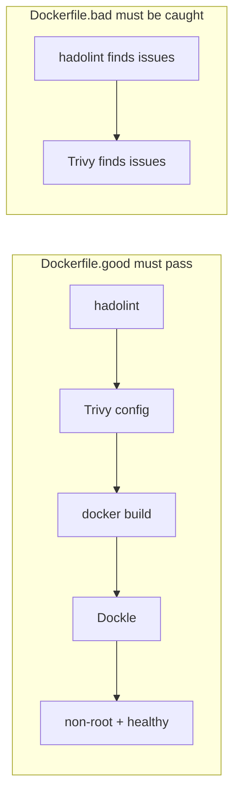

# Dockerfile security analysis: insecure vs hardened

[](https://github.com/tobolovskaya/dockerfile-security-analysis/actions/workflows/dockerfile-security.yml)

> 🇳🇴 **Kort på norsk:** To Dockerfiler side om side, en usikker og en herdet, skannet med hadolint, Trivy og Dockle i GitHub Actions. Den herdede må bestå alle skannerne og bli «healthy». Den usikre må bli fanget, ellers feiler pipelinen.

Two Dockerfiles side by side. CI checks both, in opposite directions:

- **`Dockerfile.good` must pass** hadolint, Trivy and Dockle, run as a non-root user and report `healthy`.
- **`Dockerfile.bad` must be caught.** If the scanners stop finding problems in it, the pipeline fails. This proves the scanners actually work.

**Skills shown:** Dockerfile hardening · hadolint · Trivy misconfiguration scanning · Dockle (CIS Docker Benchmark) · GitHub Actions · verified tool downloads

## What the scanners found in the insecure Dockerfile

| Line | Problem | hadolint | Trivy |
|---|---|---|---|
| `RUN apt-get install -y curl` | unpinned package version | DL3008 | |
| same | extra recommended packages installed | DL3015 | DS-0029 (high) |
| same | apt lists left in the image | DL3009 | |
| `ADD . /app` | ADD instead of COPY: can fetch URLs and unpack archives | DL3020 (error) | DS-0005 |
| no `USER` | container runs as **root** | | DS-0002 (high) |
| no `HEALTHCHECK` | orchestrator cannot tell if the app is alive | | DS-0026 |

## What the first "good" Dockerfile got wrong

The original hardened version looked right but did not work:

| Problem | Why it matters | Fix |
|---|---|---|
| `apt-get install` with **no package names** | installed nothing, so `curl` was missing | use the Python already in the base image instead of installing curl |
| `HEALTHCHECK` called `curl` on port 8443, where nothing listened | the container could **never** become healthy | the image now runs a small web server, and the health check calls it |
| health check in shell form | hadolint DL3025 | JSON form, no shell |
| named user `safeuser` | hadolint DL3066: may not resolve on the host | numeric UID `10001` |

A Dockerfile can pass a review and still be broken. Building the image and waiting for `healthy` in CI is what showed it.

## What Dockle found in the hardened image

Dockle audits the **built image**, including the base image layers, so it found things hadolint and Trivy could not see:

| Finding | Decision |
|---|---|
| CIS-DI-0008: setuid/setgid files (`su`, `passwd`, `mount`...) | **fixed**: the bits are removed in the same `RUN` that creates the user |
| DKL-DI-0005: apt caches not cleared | **accepted** in [`.dockleignore`](.dockleignore) with a written reason: a false positive. The base image cleans up with `apt-get dist-clean`, which this Dockle version does not recognise, and `Dockerfile.good` installs no packages |

## Pipeline



- Scanners are downloaded from their GitHub releases with **pinned SHA-256 checksums** ([`scripts/install-tools.sh`](scripts/install-tools.sh)).
- GitHub Actions are pinned to commit SHAs; Dependabot keeps them and the base image current.
- The findings for `Dockerfile.bad` are written to the job summary of every run.

## How to run locally

```bash
hadolint Dockerfile.bad            # shows the findings
hadolint Dockerfile.good           # clean
trivy config Dockerfile.bad
docker build -f Dockerfile.good -t hardened . && docker run --rm -p 8080:8080 hardened
```

## Hva jeg lærte / What I learned

- **Linting is not testing.** The first hardened Dockerfile passed a visual review, but the image could never become healthy. Only running it showed that.
- **Different scanners see different things.** hadolint caught ADD and unpinned packages; Trivy caught the root user and the missing health check.
- **Scan the image, not only the file.** Dockle found setuid binaries that came with the base image. An accepted finding needs a written reason, not a silent `--ignore`.
- **Test the test.** A security scan that passes everything might simply be broken. Requiring the bad Dockerfile to fail keeps the scanners honest.

---

Originally built as coursework during my MSc in Computer Science (Woolf / GoIT Neoversity) with GitLab CI, then moved to GitHub Actions and corrected.

**Yevheniia Tobolovska** · IT operations and security · [Portfolio](https://tobolovska.no) · [LinkedIn](https://www.linkedin.com/in/yevheniia-tobolovska)

License: [MIT](LICENSE)
